<picture>
  <source media="(max-width: 600px)" srcset="./assets/banner-mobile.svg">
  
</picture>

<picture>
  <source media="(max-width: 600px)" srcset="./assets/activity-mobile.svg">
  
</picture>

### Latest projects

<!-- projects:start -->
- **[Hidden Bar](https://github.com/consolelabs/hidden)** — Hide menu bar items for a cleaner Mac. Swift · ★ 16K
- **[stargazer-walkthrough](https://github.com/phucledien/stargazer-walkthrough)** — Stargazer walkthrough with a quest checklist, illustrated map atlas and downloadable PDF. HTML
- **[vibe-pad](https://github.com/phucledien/vibe-pad)** — Play your coding agents like a video game: drive the Herdr app with a DualShock 4 and talk to agents with on-device Whisper. Objective-C · ★ 5
- **[skills](https://github.com/phucledien/skills)** — Agent skills: game prototypes and design bibles from a game idea. JavaScript · ★ 1
- **[switch-localize-skill](https://github.com/phucledien/switch-localize-skill)** — A localization workflow for dialogue, fonts, menus and image text. Python · ★ 2
- **[saigon-town](https://github.com/phucledien/saigon-town)** — Open shops and bargain in a fictional Sài Gòn. CSS
<!-- projects:end -->

Updated daily by a GitHub Action · [all repositories](https://github.com/phucledien?tab=repositories)

### Connect

&nbsp;&nbsp;
