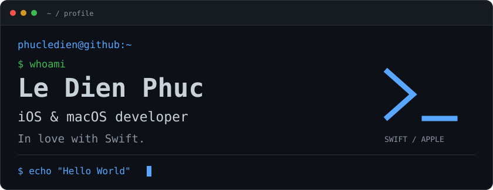
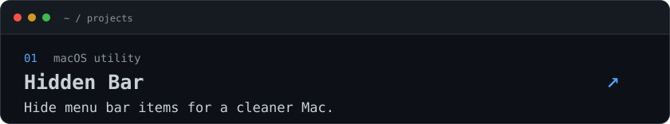
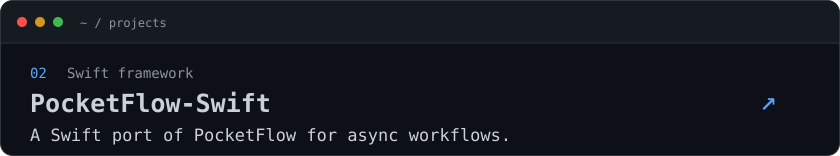
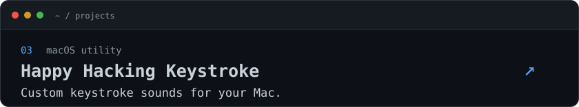
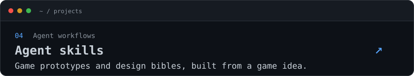
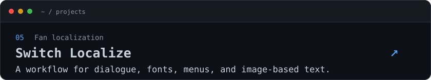
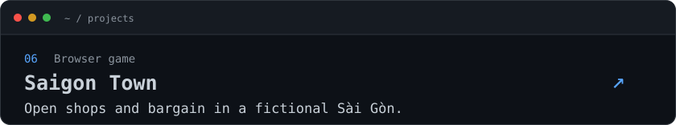
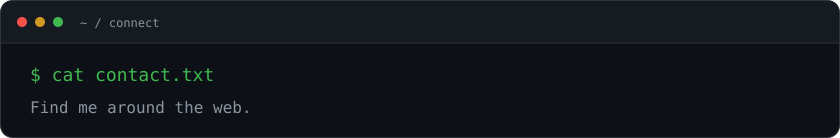

<!-- Original static terminal artwork. All images are repository-local. -->

<picture>
  <source media="(max-width: 600px)" srcset="./assets/profile-mobile.svg">
  
</picture>

## `~/projects $ ls`

<a href="https://github.com/dwarvesf/hidden">
<picture>
  <source media="(max-width: 600px)" srcset="./assets/hidden-bar-mobile.svg">
  
</picture>
</a>

<a href="https://github.com/phucledien/PocketFlow-Swift">
<picture>
  <source media="(max-width: 600px)" srcset="./assets/pocketflow-swift-mobile.svg">
  
</picture>
</a>

<a href="https://github.com/phucledien/happy-hacking-keystroke">
<picture>
  <source media="(max-width: 600px)" srcset="./assets/happy-hacking-keystroke-mobile.svg">
  
</picture>
</a>

<a href="https://github.com/phucledien/skills">
<picture>
  <source media="(max-width: 600px)" srcset="./assets/skills-mobile.svg">
  
</picture>
</a>

<a href="https://github.com/phucledien/switch-localize-skill">
<picture>
  <source media="(max-width: 600px)" srcset="./assets/switch-localize-mobile.svg">
  
</picture>
</a>

<a href="https://github.com/phucledien/saigon-town">
<picture>
  <source media="(max-width: 600px)" srcset="./assets/saigon-town-mobile.svg">
  
</picture>
</a>

[Play Saigon Town](https://saigontown.phucld.com/) · [Browse all repositories](https://github.com/phucledien?tab=repositories)

Plain-text profile and project index

**Le Dien Phuc** · [@phucledien](https://github.com/phucledien)  
iOS and macOS developer. In love with Swift.

- [Hidden Bar](https://github.com/dwarvesf/hidden): Hide menu bar items for a cleaner Mac.
- [PocketFlow-Swift](https://github.com/phucledien/PocketFlow-Swift): A Swift port of PocketFlow for async workflows.
- [Happy Hacking Keystroke](https://github.com/phucledien/happy-hacking-keystroke): Custom keystroke sounds for your Mac.
- [Agent skills](https://github.com/phucledien/skills): Game prototypes and design bibles, built from a game idea.
- [Switch Localize](https://github.com/phucledien/switch-localize-skill): A workflow for dialogue, fonts, menus, and image-based text.
- [Saigon Town](https://github.com/phucledien/saigon-town): Open shops and bargain in a fictional Sài Gòn.

<picture>
  <source media="(max-width: 600px)" srcset="./assets/contact-mobile.svg">
  
</picture>

[Website](https://phucld.com) · [X](https://twitter.com/phucledien) · [Mastodon](https://mastodon.social/@phucld) · [Bluesky](https://bsky.app/profile/oliverle.com) · [Farcaster](https://warpcast.com/ol)
