<picture>
  <source media="(max-width: 600px)" srcset="./assets/profile-mobile.svg">
  
</picture>

### Featured projects

<!-- projects:start -->
- **[Hidden Bar](https://github.com/consolelabs/hidden)** — Hide menu bar items for a cleaner Mac. Swift · ★ 16K
- **[skills](https://github.com/phucledien/skills)** — Agent skills: game prototypes and design bibles from a game idea. JavaScript · ★ 1
- **[switch-localize-skill](https://github.com/phucledien/switch-localize-skill)** — A localization workflow for dialogue, fonts, menus and image text. Python · ★ 2
- **[PocketFlow-Swift](https://github.com/phucledien/PocketFlow-Swift)** — A Swift port of the minimalist LLM workflow framework PocketFlow. Swift · ★ 10
- **[happy-hacking-keystroke](https://github.com/phucledien/happy-hacking-keystroke)** — Custom keystroke sounds for your Mac. Swift · ★ 8
- **[saigon-town](https://github.com/phucledien/saigon-town)** — Open shops and bargain in a fictional Sài Gòn. CSS
<!-- projects:end -->

Pinned repositories, refreshed daily · [all repositories](https://github.com/phucledien?tab=repositories)

### Connect

&nbsp;&nbsp;
